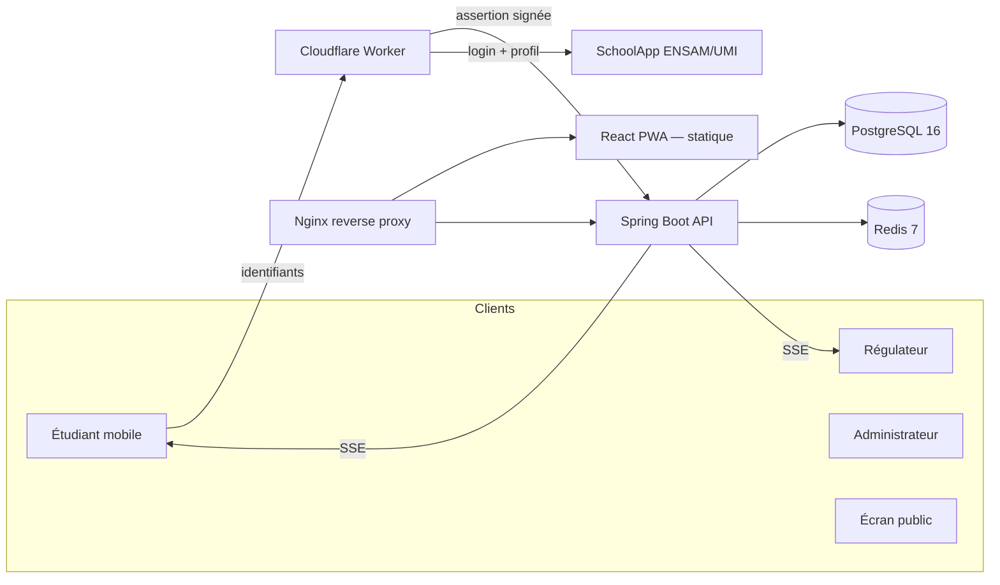
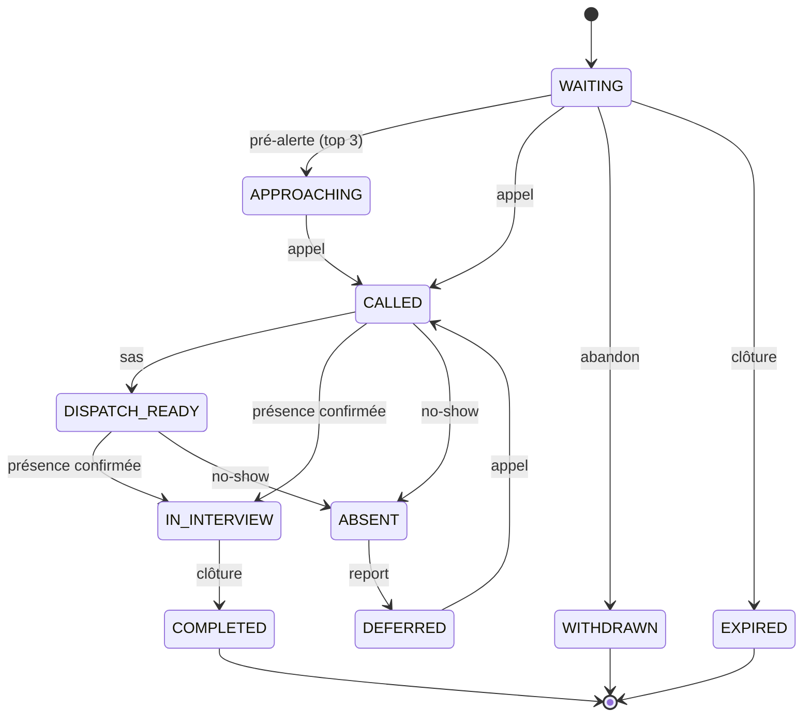
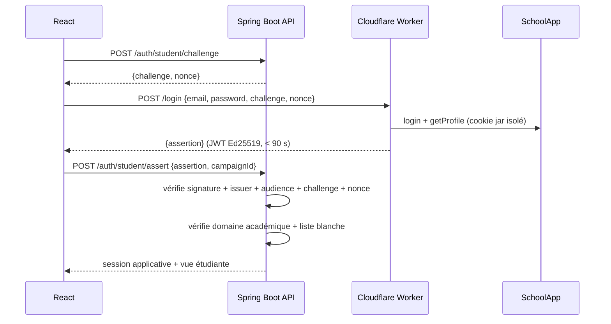

<div align="center">


# FAME — Forum Art & Métiers Entreprises

**Plateforme d'organisation des forums de recrutement et des entretiens de fin d'études (PFE).**


</div>

---

## Sommaire

1. [Ce que c'est](#ce-que-cest)
2. [Le problème résolu](#le-problème-résolu)
3. [Rôles et permissions](#rôles-et-permissions)
4. [Fonctionnalités](#fonctionnalités)
5. [Architecture](#architecture)
6. [Modèle de données](#modèle-de-données)
7. [La file d'attente FIFO](#la-file-dattente-fifo)
8. [Authentification](#authentification)
9. [Démarrage rapide](#démarrage-rapide)
10. [Configuration](#configuration)
11. [Développement](#développement)
12. [Tests](#tests)
13. [Sécurité](#sécurité)
14. [Déploiement](#déploiement)
15. [Structure du dépôt](#structure-du-dépôt)
16. [Documentation](#documentation)
17. [Décisions en attente](#décisions-en-attente)

---

## Ce que c'est

FAME remplace le processus manuel qui entoure les forums de recrutement : feuilles d'inscription au stylo, files d'attente coordonnées à la voix, recherche d'un candidat par filière dans un tableur partagé, synchronisation approximative entre les membres du comité.

Concrètement, FAME permet à un comité d'organisation de :

- **créer une campagne** (un événement, une entreprise) avec sa propre file d'attente, son QR code et ses données isolées ;
- **importer la liste blanche** des étudiants éligibles depuis un CSV ;
- **laisser les étudiants s'inscrire eux-mêmes** via leur compte institutionnel SchoolApp ;
- **faire tourner la file** : appeler, dispatcher, marquer les absents, clôturer les entretiens, gérer les pauses ;
- **piloter la salle** sur un plan 2D reproduisant la disposition physique des tables ;
- **notifier les candidats** (Web Push + in-app) et diffuser un écran public ;
- **analyser l'événement** après coup (temps d'attente, no-show, débit, utilisation des postes).

Le serveur est l'autorité sur tout ce qui compte : l'ordre FIFO, les horodatages, l'éligibilité, les transitions d'état, les affectations. Le client React n'est jamais une source de vérité.

---

## Le problème résolu

Le document d'analyse *As-Is / Gap Analysis* identifie les difficultés du processus actuel. FAME y répond point par point :

| Difficulté observée | Réponse dans FAME |
|---|---|
| Contestations sur l'ordre « premier arrivé, premier servi » | Séquence et horodatage attribués côté serveur, déterministes |
| Recherche manuelle du candidat qui correspond à une filière | Filtrage FIFO par filière, instantané, côté serveur |
| Candidat introuvable au moment de l'appel | Statut `ABSENT` + proposition immédiate du candidat suivant |
| Besoins des recruteurs qui changent en cours de journée | Modification de la filière d'un poste, atomique, rafraîchit la vue |
| Coordination manuelle inscription / appels | État partagé temps réel (SSE + Redis Pub/Sub) |
| Étudiants qui contournent la conférence | Exigence « souhaitable », non verrouillée (voir [décisions](#décisions-en-attente)) |

---

## Rôles et permissions

Quatre rôles, appliqués **côté serveur** sur chaque route :

| Rôle | Qui | Ce qu'il peut faire |
|---|---|---|
| `SUPERADMIN` | L'email institutionnel configuré (`fame.admin.email`), vérifié via SchoolApp | Tout, y compris le centre de contrôle `/admin` |
| `ADMIN` | Administrateur plateforme (compte local) | Créer/gérer les campagnes, les entreprises, les listes d'éligibilité |
| `ORGANIZER` | Régulateur assigné à une ou plusieurs campagnes | Opérer **uniquement** ses campagnes : files, postes, appels, pauses |
| `STUDENT` | Étudiant authentifié via SchoolApp | S'inscrire, voir **son** statut, se retirer, recevoir ses notifications |

Points de sécurité non négociables :

- Un régulateur de la campagne A ne voit ni ne modifie la campagne B.
- Un étudiant ne voit jamais la file globale, l'identité des autres, ni les statistiques privées.
- Le rôle `SUPERADMIN` n'est **jamais** auto-attribué par le frontend : il résulte d'une comparaison serveur entre l'email institutionnel vérifié et la configuration.
- Les guards React sont une mesure d'ergonomie ; l'autorisation réelle est dans le backend.

---

## Fonctionnalités

### Campagnes

- Cycle de vie complet : `DRAFT → ACTIVE ⇄ PAUSED → CLOSED → ARCHIVED`, validé côté serveur.
- Isolation logique multi-locataire : chaque campagne possède sa file, son roster, ses postes et son journal.
- Assignation d'organisateurs, d'entreprises et de recruteurs.
- QR code / URL d'accès par campagne.
- Duplication de configuration, archivage sans perte d'historique.

### Inscription et éligibilité

- Double validation : domaine académique autorisé **et** présence dans la liste blanche importée.
- Import CSV avec détection de doublons, lignes malformées et résumé d'import (`imported` / `duplicates` / `errors`).
- Compte de secours : identifiant + mot de passe temporaire à usage unique, généré après vérification physique de la carte étudiant, remplacement obligatoire du mot de passe au premier usage, expiration 30 min.
- Abandon volontaire (« quitter la file ») qui retire immédiatement le profil des filtres.

### File d'attente et dispatch

- FIFO déterministe (`sequence_no` monotone + `arrival_at` serveur).
- Appel, préparation (sas), confirmation de présence, absence, report, clôture, retrait.
- Anti-famine : si aucune correspondance sur la filière demandée, suggestion FIFO des autres filières — sans affectation implicite.
- Verrouillage anti-collision : `SELECT … FOR UPDATE SKIP LOCKED` + `@Version` ; testé avec des appels concurrents.

### Postes et plan 2D de la salle

- Postes avec recruteur, filière demandée, statut (`AVAILABLE` / `OCCUPIED` / `PAUSED`), position et libellé de localisation.
- Plan interactif glisser-déposer (souris + tactile), persistant, restauré après refresh/reconnexion.
- Statut indiqué par couleur **et** par texte (pas de couleur seule).

### Temps réel

- SSE comme canal primaire serveur → client, fan-out via Redis Pub/Sub (multi-instances prêt).
- Repli par polling côté client.
- Un étudiant reçoit un flux **par étudiant** ; jamais le flux global de la campagne.

### Notifications

- Web Push (VAPID) + notifications in-app.
- Payloads minimaux : aucun mot de passe, token de session, téléphone ni donnée académique sensible.
- Déduplication, retries bornés, historique de livraison, gestion des abonnements expirés.
- Repli documenté : l'app reste pleinement utilisable sans push.

### Centre de contrôle superadmin (`/admin`)

- Vue d'ensemble (agrégats réels).
- Gestion des utilisateurs : recherche, désactivation, rôle, révocation de sessions.
- Journal d'audit append-only (aucun `DELETE`) + export CSV.
- Centre de notifications : composeur, ciblage par segment, modèles, suivi de livraison.
- Configuration : vue sûre (jamais les secrets) + paramètres métier persistants.
- Santé système, gestion des données (compteurs, archivage, exports).

Détail : [`docs/superadmin.md`](docs/superadmin.md).

### Analyses et exports

- KPIs définis mathématiquement : temps d'attente moyen/médian, durée d'entretien, taux de no-show, volume par filière, utilisation des postes.
- Export CSV/JSON protégé, avec neutralisation de l'injection de formule CSV.

---

## Architecture



### Composants

**Frontend** (`apps/web`) — React 18 + TypeScript, Vite, TanStack Query, React Router 7, `vite-plugin-pwa`. PWA installable (manifest + service worker + gestion `push`/`notificationclick`). Interface mobile-first pour l'étudiant, responsive pour le régulateur.

**Backend** (`services/api`) — Spring Boot 3.3.5 sur Java 17. Modules : `domain` (entités JPA), `repository`, `service` (logique métier : `QueueEngine`, `AuthService`, `CampaignService`, `AnalyticsService`, `NotificationCommandService`…), `web` (contrôleurs REST + DTO), `security`, `realtime`, `factory` (patrons de création).

**Worker** (`workers/schoolapp-auth`) — Cloudflare Worker, URL `https://schoolapp-auth.gadzarts.xyz`. Vérifie les identifiants SchoolApp et émet une assertion Ed25519 à usage unique. Détail : [`workers/schoolapp-auth/README.md`](workers/schoolapp-auth/README.md).

**Infrastructure** (`infra/`, `docker-compose.yml`) — PostgreSQL 16, Redis 7, Nginx, scripts de backup/restauration, CI GitHub Actions.

### Pourquoi SSE plutôt que WebSocket

Le cahier des charges demandait du temps réel avec un repli. FAME utilise **SSE comme canal primaire** et le **polling comme repli**, plutôt que WebSocket, pour des raisons pratiques :

- SSE traverse les proxies et ne nécessite pas de configuration de session particulière (cookie HTTP classique).
- Reconnexion automatique native côté navigateur.
- Une seule direction (serveur → client) suffit : les actions passent par l'API REST.

C'est une décision documentée, pas une omission.

---

## Modèle de données

```mermaid
erDiagram
    APP_USER ||--o{ CAMPAIGN : "propriétaire"
    APP_USER ||--o{ CAMPAIGN_MEMBER : ""
    COMPANY ||--o{ CAMPAIGN : ""
    COMPANY ||--o{ RECRUITER : ""
    CAMPAIGN ||--o{ ROSTER_ENTRY : ""
    CAMPAIGN ||--o{ STATION : ""
    RECRUITER ||--o{ STATION : ""
    CAMPAIGN ||--o{ STUDENT_REGISTRATION : ""
    STATION ||--o{ STUDENT_REGISTRATION : ""
    CAMPAIGN ||--o{ QUEUE_EVENT : ""
    STUDENT_REGISTRATION ||--o{ PUSH_SUBSCRIPTION : ""
    CAMPAIGN ||--o{ RECOVERY_ACCOUNT : ""
    STUDENT_REGISTRATION ||--o{ BROADCAST_RECIPIENT : ""
    BROADCAST ||--o{ BROADCAST_RECIPIENT : ""

    APP_USER { uuid id PK; string username UK; string password_hash; role role; bool enabled }
    CAMPAIGN { uuid id PK; string name; CampaignStatus status; bigint version }
    ROSTER_ENTRY { uuid id PK; string student_code; UK(campaign_id, student_code) }
    STATION { uuid id PK; string filiere; StationStatus status; double pos_x; double pos_y }
    STUDENT_REGISTRATION { uuid id PK; bigint sequence_no; timestamp arrival_at; QueueStatus status; UK(campaign_id, student_code) }
    QUEUE_EVENT { uuid id PK; string action; timestamp occurred_at }
```

Faits notables :

- `sequence_no` provient d'une séquence PostgreSQL (`registration_seq`) — ordre global monotone, déterministe par campagne.
- `(campaign_id, student_code)` est unique : l'inscription en double est impossible au niveau base.
- L'affectation candidate→poste est verrouillée par `FOR UPDATE SKIP LOCKED` ; les postes ont une colonne `@Version` pour les mises à jour optimistes.
- Les migrations sont gérées par Flyway (`V1__init.sql`, `V2__admin_control_center.sql`).

---

## La file d'attente FIFO



La machine à états est implémentée dans `QueueStateMachine` ; toute transition non autorisée est rejetée (`409 INVALID_TRANSITION`). Le détail de chaque état et des transitions est dans [`docs/queue-state-machine.md`](docs/queue-state-machine.md).

---

## Authentification



Garanties :

- La clé privée de signature vit **uniquement** dans les secrets Cloudflare Worker ; le backend n'a que la clé publique.
- L'assertion est liée à un challenge serveur et à un nonce à usage unique (anti-rejeu atomique).
- Le frontend ne reçoit jamais la clé de signature, et le backend n'accepte jamais un identifiant ou une éligibilité « fournis par le navigateur ».

Le flux complet et la frontière de confiance sont documentés dans [`docs/auth-trust-boundary.md`](docs/auth-trust-boundary.md).

---

## Démarrage rapide

Prérequis : Docker + Docker Compose, Node 20+, JDK 17+.

```bash
cp .env.example .env               # variables infra (Postgres / Redis)
cp config.yml.example config.yml   # configuration du backend
# renseigner les secrets dans config.yml (voir ci-dessous)

docker compose up --build
```

- Frontend : http://localhost:8080
- API / OpenAPI : http://localhost:8080/api/v1/docs
- Healthcheck : http://localhost:8080/actuator/health

PostgreSQL et Redis restent sur un réseau interne ; seul le proxy web (Nginx) est exposé.

---

## Configuration

La configuration est répartie en trois endroits, volontairement séparés :

| Fichier | Contenu |
|---|---|
| `config.yml` | Configuration applicative du backend (datasource, Redis, worker, VAPID, superadmin, CORS). Template : `config.yml.example`. |
| `.env` | Variables d'infrastructure Docker (Postgres/Redis). Template : `.env.example`. |
| `apps/web/.env` | Configuration build-time du frontend (`VITE_WORKER_URL`, `VITE_API_BASE_URL`). Template : `apps/web/.env.example`. |

Le backend charge `config.yml` via `spring.config.import: optional:file:./config.yml` (monté en lecture seule dans `/app/config.yml` dans Docker). Les secrets ne sont **jamais** commités : seuls les templates `*.example` le sont.

Liste des clés et des secrets : [`docs/secrets.md`](docs/secrets.md) et [`docs/deployment.md`](docs/deployment.md).

---

## Développement

### Backend

```bash
cd services/api
./gradlew compileJava   # compilation
./gradlew test          # unités + intégration (Testcontainers)
./gradlew bootRun       # lancement (nécessite Postgres + Redis)
```

### Frontend

```bash
cd apps/web
npm install
npm run dev             # Vite (proxy /api → :8080)
npm run build           # build de production + PWA
```

### Worker

```bash
cd workers/schoolapp-auth
npm install
npm test
npx wrangler dev        # développement local
npx wrangler deploy     # déploiement
```

---

## Tests

Trois suites, toutes exécutées et vertes :

| Suite | Cadre | Tests | Commandes |
|---|---|---|---|
| Backend | JUnit 5 + Testcontainers (Postgres/Redis) | **40** | `cd services/api && ./gradlew test` |
| Frontend | Vitest + Testing Library | **8** | `cd apps/web && npm test` |
| Worker | Vitest (upstream mocké) | **6** | `cd workers/schoolapp-auth && npm test` |

Points couverts côté backend : file FIFO, transitions d'état, double affectation en concurrence, isolation inter-campagnes, vérification d'assertion (signature/rejeu/nonce), résolution de l'identité superadmin, autorisation des endpoints admin, ciblage des notifications, validation de configuration, patrons de création.

Le détail des tests de sécurité admin est dans [`docs/verification.md`](docs/verification.md).

---

## Sécurité

La démarche de sécurité est documentée et factuelle — elle ne prétend pas avoir testé « toutes les attaques » :

- **Modèle de menace** (STRIDE) : [`reports/security/threat-model.md`](reports/security/threat-model.md).
- **Matrice menace → test** : [`reports/security/test-matrix.md`](reports/security/test-matrix.md).
- **Constatations** (sévérité, preuves, remédiation, retest) : [`reports/security/findings.md`](reports/security/findings.md).
- **Résumé machine-lisible** : [`reports/security/summary.json`](reports/security/summary.json).

Mesures structurelles :

- Sessions Redis (`HttpOnly`, `Secure`, `SameSite=Lax`, rotation anti-fixation).
- CSRF par cookie `XSRF-TOKEN` + en-tête `X-XSRF-TOKEN`.
- DTO stricts (pas de mass assignment), requêtes paramétrées, headers de sécurité (CSP, `frame-ancestors none`).
- Rate limiting (Redis), limites de taille de requête, timeouts, healthchecks sans détail.
- `npm audit --omit=dev` = 0 vulnérabilité de production (web + worker).

Les données personnelles des étudiants sont traitées en tenant compte de la loi 09-08 et des recommandations CNDP (revue juridique dédiée non incluse dans ce dépôt).

---

## Déploiement

### Docker (self-hosted)

```bash
cp .env.example .env
cp config.yml.example config.yml
# éditer les deux fichiers
docker compose up -d --build
docker compose ps            # vérifier les healthchecks
```

Backup / restauration :

```bash
infra/scripts/backup.sh  /backups/fame-$(date +%F).sql.gz
infra/scripts/restore.sh /backups/fame-2026-01-01.sql.gz
```

### Cloudflare Worker

```bash
cd workers/schoolapp-auth
npx wrangler secret put SIGNING_PRIVATE_KEY
npx wrangler deploy
curl https://schoolapp-auth.gadzarts.xyz/public-key   # récupérer la clé publique
```

Puis reporter la clé publique dans `config.yml` (`fame.worker.public-key`) et l'émetteur (`fame.worker.issuer`).

### HTTPS

Nginx sert en HTTP ; terminer TLS en amont (Cloudflare, load balancer, `certbot`) et passer `X-Forwarded-Proto`. Activer alors `server.servlet.session.cookie.secure: true` et `fame.cors.origins=https://<domaine>` dans `config.yml`.

Le guide complet (variables, Worker, rollback) : [`docs/deployment.md`](docs/deployment.md).

---

## Structure du dépôt

```
FAME/
├── apps/
│   └── web/                      Frontend React + TypeScript + PWA
│       ├── src/
│       │   ├── api/              client typé (api + adminApi)
│       │   ├── auth/             contexte de session
│       │   ├── components/       AppShell, AdminShell, badges
│       │   ├── i18n/             fr / en
│       │   ├── lib/              SSE, push
│       │   └── pages/            étudiant, régulateur, admin
│       └── tests/
├── services/
│   └── api/                      Backend Spring Boot
│       └── src/main/java/ma/ensam/fame/
│           ├── common/           erreurs, exceptions
│           ├── config/           sécurité, propriétés, initialisation
│           ├── domain/           entités JPA
│           ├── factory/          patrons de création
│           ├── realtime/         SSE + Redis
│           ├── repository/       Spring Data
│           ├── security/         principaux, vérification d'assertion
│           ├── service/          logique métier
│           └── web/              contrôleurs REST (+ web/admin)
├── workers/
│   └── schoolapp-auth/           Cloudflare Worker (auth SchoolApp)
├── infra/
│   ├── scripts/                  backup / restore
│   └── proxy/                    configuration Nginx (dans apps/web)
├── tests/
│   ├── e2e/                      playbook Playwright
│   ├── load/                     playbook k6
│   └── security/
├── reports/
│   └── security/                 modèle de menace, findings, matrice
├── docs/                         architecture, base, état-machine, traçabilité…
├── docker-compose.yml
├── docker-compose.test.yml
├── config.yml.example
└── .env.example
```

---

## Documentation

| Document | Sujet |
|---|---|
| [`docs/architecture.md`](docs/architecture.md) | Composants et choix techniques |
| [`docs/auth-trust-boundary.md`](docs/auth-trust-boundary.md) | Flux d'authentification et frontières de confiance |
| [`docs/database.md`](docs/database.md) | Modèle de données et cohérence |
| [`docs/queue-state-machine.md`](docs/queue-state-machine.md) | Machine à états de la file |
| [`docs/requirements-traceability.md`](docs/requirements-traceability.md) | Matrice exigence → implémentation → test |
| [`docs/superadmin.md`](docs/superadmin.md) | Centre de contrôle superadmin |
| [`docs/deployment.md`](docs/deployment.md) | Déploiement Docker + Worker |
| [`docs/secrets.md`](docs/secrets.md) | Gestion des secrets et rotation |
| [`docs/pwa.md`](docs/pwa.md) | PWA et notifications push |
| [`docs/backup-restore.md`](docs/backup-restore.md) | Sauvegarde et restauration |
| [`docs/monitoring.md`](docs/monitoring.md) | Observabilité et réponse aux incidents |
| [`docs/development.md`](docs/development.md) | Guide de développement et de test |
| [`docs/verification.md`](docs/verification.md) | Preuves d'exécution (tests, smoke) |
| [`workers/schoolapp-auth/README.md`](workers/schoolapp-auth/README.md) | Worker SchoolApp |

---

## Décisions en attente

Certaines règles métier restent des décisions humaines, laissées volontairement non verrouillées :

1. **Pénalité no-show** — le comportement de report/requeue après une absence (déclassement, priorité) n'est pas fixé. L'état `DEFERRED` existe, mais la politique précise est à définir avec le comité.
2. **Participation à la conférence** — le *Gap Analysis* la note « souhaitable ». FAME ne l'impose pas aujourd'hui.
3. **Mode d'affichage public** — `FIRST_NAME` (défaut) ou `CODE` ; configurable par campagne.
4. **Canal email** — aucun fournisseur email n'est intégré ; le centre de notifications n'expose donc que Web Push + in-app, et le segment « éligibles non inscrits » est résolu à vide (documenté, pas simulé).

---

## Licence

Aucune licence n'est encore fixée pour ce dépôt (la bibliothèque `schoolapp.js` vendée est, elle, sous MIT).
