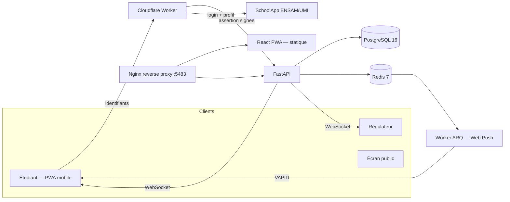
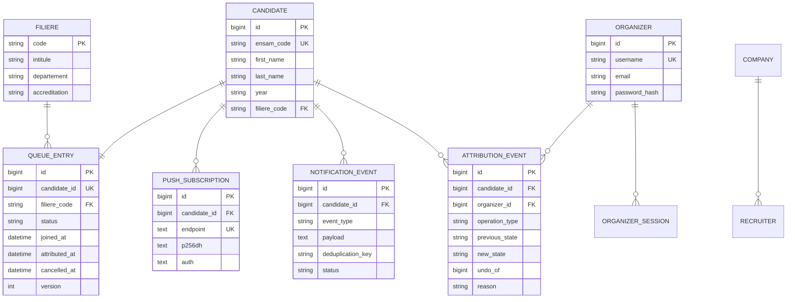
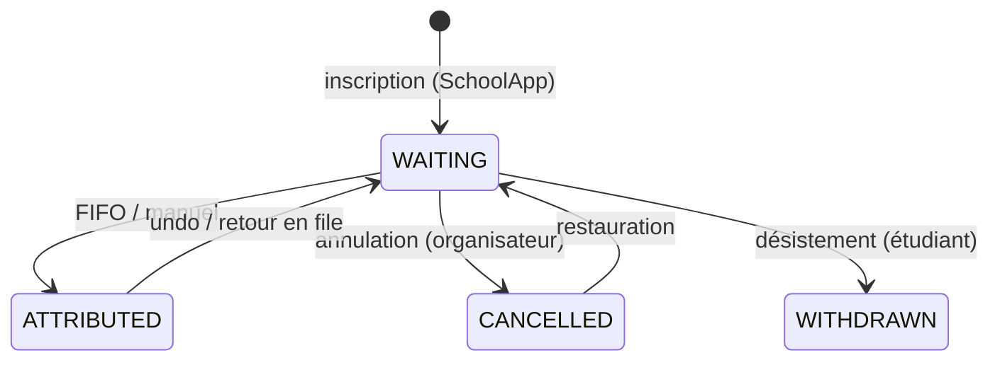
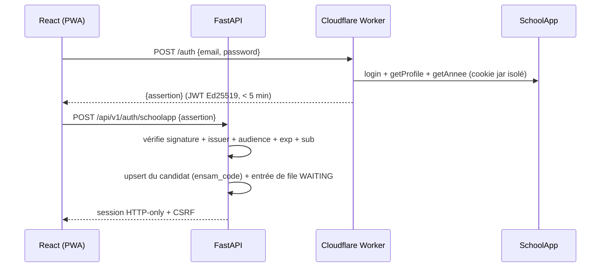

<div align="center">


# FAME — File d'attente & Attribution des Recrutements

**Plateforme de file d'attente temps réel et d'attribution des candidats pour les forums de recrutement de l'ENSAM Meknès.**


</div>

---

## Sommaire

1. [Ce que c'est](#ce-que-cest)
2. [Rôles et permissions](#rôles-et-permissions)
3. [Fonctionnalités](#fonctionnalités)
4. [Architecture](#architecture)
5. [Modèle de données](#modèle-de-données)
6. [La file d'attente FIFO](#la-file-dattente-fifo)
7. [Authentification](#authentification)
8. [Démarrage rapide](#démarrage-rapide)
9. [Configuration](#configuration)
10. [Développement](#développement)
11. [Tests](#tests)
12. [Sécurité](#sécurité)
13. [Déploiement](#déploiement)
14. [Structure du dépôt](#structure-du-dépôt)
15. [Documentation](#documentation)
16. [Licence](#licence)

---

## Ce que c'est

FAME remplace la gestion manuelle des files d'attente lors d'un événement de recrutement : feuilles d'inscription au stylo, appels à la voix, recherche d'un candidat par filière dans un tableur, synchronisation approximative entre les membres du comité.

Concrètement, FAME permet à un **comité d'organisation** de :

- **laisser les étudiants s'inscrire eux-mêmes** via leur compte institutionnel **SchoolApp** ;
- **faire tourner la file** : attribuer le candidat suivant en un clic (FIFO), ou un candidat précis (manuel), puis **annuler**, **remettre en file** ou **annuler** chaque opération ;
- **piloter un événement unique** : une entreprise, une ou plusieurs filières, chacune avec sa propre file FIFO ;
- **notifier les candidats** par Web Push (VAPID) même application fermée, et diffuser un **écran public** ;
- **reconstituer tout l'historique** des attributions grâce à un journal d'audit immuable.

Le serveur est l'autorité sur tout ce qui compte : l'ordre FIFO, les horodatages, l'éligibilité, les transitions d'état, les attributions. Le client React n'est jamais une source de vérité.

---

## Rôles et permissions

Trois rôles, appliqués **côté serveur** sur chaque route :

| Rôle | Qui | Ce qu'il peut faire |
|---|---|---|
| `CANDIDATE` | Étudiant authentifié via SchoolApp | Voir **son** statut et sa position, installer la PWA, activer les notifications, se retirer de la file |
| `ORGANIZER` | Membre du comité (compte dédié) | Attribuer (FIFO / manuel), annuler, remettre en file, annuler un candidat, annuler la dernière opération, consulter l'historique |
| `RECRUITER` | Métadonnée associée à l'entreprise | Aucune attribution ni file propre — simple information |

Points de sécurité non négociables :

- Un étudiant ne voit jamais la file globale, l'identité des autres candidats, ni les statistiques privées.
- L'authentification organisateur est **séparée** de l'authentification SchoolApp : mot de passe Argon2id, session HTTP-only, CSRF.
- Un étudiant n'est identifié que par son `ensamCode` (jamais par son nom).
- Les guards React sont une mesure d'ergonomie ; l'autorisation réelle est dans le backend.

---

## Fonctionnalités

### File d'attente et attribution

- FIFO déterministe par filière, position **calculée** (jamais persistée) à partir de `joined_at` + `id`.
- Attribution atomique : `SELECT … FOR UPDATE SKIP LOCKED`, testée en concurrence.
- Attribution manuelle par recherche (nom, code ENSAM, filière, année).
- **Réversibilité totale** : annuler, remettre en file, annuler, restaurer, « annuler la dernière opération ».
- Journal d'audit **append-only** : aucun `DELETE`, l'annulation crée un nouvel événement lié (`undo_of`).

### Temps réel

- **WebSocket** : flux par filière pour les candidats, flux global pour les organisateurs.
- Reconnexion automatique côté client.
- L'écran public (polling) diffuse les appels et les prochains candidats.

### Notifications

- **Web Push** (VAPID) délivrées par un worker **ARQ** (Redis), même application fermée.
- Déduplication sur fenêtre temporelle, retries avec backoff exponentiel, invalidation des abonnements expirés (`410`).
- Seuils configurables : `IMMEDIATE` (position 1), `URGENT` (≤ 2), `APPROACHING` (≤ 5).
- TTL non nul : les messages sont mis en file pendant le Doze Android au lieu d'être abandonnés.

### PWA

- Installable (manifest + service worker), gestion `push` / `notificationclick`.
- Page « ticket » minimaliste : rang actuel, statut, filière, progression.
- Activation des notifications + installation manuelle (iOS).

Détail : [`docs/pwa.md`](docs/pwa.md).

---

## Architecture



### Composants

**Frontend** (`fame-react`) — React 19 + TypeScript, Vite, routage par hash (`#/login`, `#/student`, `#/organizer`, `#/public`). PWA installable (manifest + `public/sw.js` avec gestion `push`/`notificationclick`). Interface mobile-first pour l'étudiant, responsive pour l'organisateur, écran public dédié.

**Backend** (`backend`) — FastAPI + SQLAlchemy 2 (async) + Alembic. Modules : `models`, `schemas`, `repositories`, `services` (queue, attribution, notifications), `api/v1`, `websocket`, `workers`, `security`.

**Worker** (`workers/notifications.py`) — ARQ (Redis) : délivre les notifications Web Push hors requête.

**Worker SchoolApp** (`schoolapp.js`) — Cloudflare Worker. Authentifie l'étudiant via la bibliothèque [`schoolapp.js`](https://github.com/NacreousDawn596/schoolapp.js) (vendue dans `vendor/schoolapp/`) et émet une assertion Ed25519 à courte durée de vie.

**Infrastructure** (`infra/`, `docker-compose.yml`) — PostgreSQL 16, Redis 7, Nginx, images Docker multi-étapes.

### Pourquoi WebSocket plutôt que SSE

FAME utilise **WebSocket** pour la synchronisation temps réel : le canal candidat est bidirectionnel (le client peut s'abonner/se réabonner), et les mises à jour sont poussées par filière. C'est un choix documenté, pas une omission.

---

## Modèle de données



Faits notables :

- `candidate_id` est **unique** dans `queue_entries` : une seule entrée de file par candidat, réutilisée à chaque transition. Lorsqu'une attribution est annulée, `joined_at` est remis à « maintenant » : le candidat **revient en bas de sa file**.
- La position est **calculée** via une fonction fenêtre (`ROW_NUMBER`) ou un `COUNT`, jamais stockée.
- `attribution_events` est append-only : l'annulation référence l'événement d'origine via `undo_of`.
- Le catalogue des filières (37 enregistrements) est seedé par la migration initiale et par le script de seed.

Détail : [`docs/database.md`](docs/database.md).

---

## La file d'attente FIFO



La position est déterministe sur `(joined_at, id)`. Toute transition est enregistrée dans `attribution_events` avec l'état précédent et le nouveau. Une attribution annulée **replace le candidat en bas de sa file** (au lieu de restaurer sa position d'origine). À chaque attribution, les **5 candidats suivants** de la filière sont notifiés (push, WhatsApp, e-mail). Le détail est dans [`docs/queue.md`](docs/queue.md).

---

## Authentification



Garanties :

- La clé privée de signature vit **uniquement** dans les secrets Cloudflare Worker ; le backend n'a que la clé publique.
- Le frontend n'est jamais cru : il transmet une assertion signée, jamais une identité en clair.
- L'organisateur utilise un compte dédié (Argon2id, session HTTP-only, CSRF, rate limiting), totalement séparé de SchoolApp.

Le flux complet et la frontière de confiance sont documentés dans [`docs/authentication.md`](docs/authentication.md).

---

## Démarrage rapide

Prérequis : Docker + Docker Compose.

```bash
cp .env.example .env                # renseigner les secrets
cd backend && uv run python ../scripts/generate_keys.py   # clés SchoolApp + VAPID
docker compose up -d --build
```

- Application (PWA + dashboard) : http://localhost:5483
- API : http://localhost:5483/api/v1
- Healthcheck : http://localhost:5483/api/v1/health

PostgreSQL et Redis restent sur un réseau interne ; seul le proxy web (Nginx) est exposé, sur un port unique.

---

## Configuration

| Fichier | Contenu |
|---|---|
| `.env` | Toute la configuration (base, Redis, SchoolApp, VAPID, sessions, organisateurs). Template : `.env.example`. |
| `wrangler.toml` | Configuration du Cloudflare Worker (vars). La clé privée de signature est un **secret**, pas un var. |

Les secrets ne sont **jamais** commités : seuls les templates (`*.example`) le sont. La liste complète des clés et des secrets est dans [`docs/secrets.md`](docs/secrets.md) et [`docs/deployment.md`](docs/deployment.md).

---

## Développement

### Backend

```bash
cd backend
uv sync --extra dev
uv run alembic upgrade head      # migrations
uv run uvicorn app.main:app --reload --port 8000
```

### Frontend

```bash
cd fame-react
npm install
npm run dev                     # Vite (proxy /api → :8000)
npm run build                   # build de production + PWA
```

### Worker

```bash
npx wrangler dev                # développement local
npx wrangler deploy             # déploiement
npx wrangler secret put SCHOOLAPP_PRIVATE_KEY
```

Détail : [`docs/development.md`](docs/development.md).

---

## Tests

| Suite | Cadre | Tests | Commandes |
|---|---|---|---|
| Backend | pytest (PostgreSQL réel) | **27** | `cd backend && uv run pytest` |
| Frontend | TypeScript `tsc` | — | `cd fame-react && npm run typecheck` |

Points couverts côté backend : vérification d'assertion SchoolApp, inscription et déduplication `ensam_code`, résolution de filière, ordre FIFO, attribution FIFO/manuelle, annulation, restauration, annulation de la dernière opération, **concurrence FIFO** (pas de double attribution), calcul de position, autorisation organisateur, gestion des abonnements push, déduplication des notifications, autorisation WebSocket, cycle de vie complet HTTP.

---

## Sécurité

Mesures structurelles :

- **Auth** : Argon2id (organisateur), JWT signé (session candidat), assertion Ed25519 (SchoolApp).
- **Sessions** : cookies HTTP-only + `SameSite`, CSRF par en-tête `X-CSRF-Token`.
- **Autorisation** : chaque endpoint protégé vérifie le rôle côté serveur.
- **Rate limiting** (Redis), validation d'entrée (Pydantic), ORM paramétré (pas d'injection SQL), headers de sécurité.
- **VAPID** : clé privée uniquement dans l'environnement, jamais dans une image.
- **Minimisation** : un candidat n'est identifié que par `ensamCode` ; le client ne reçoit jamais les données des autres candidats.

Détail : [`docs/security.md`](docs/security.md).

---

## Déploiement

### Docker (self-hosted)

```bash
cp .env.example .env
# éditer .env
docker compose up -d --build
docker compose ps                 # vérifier les healthchecks
```

### Cloudflare Worker

```bash
npx wrangler secret put SCHOOLAPP_PRIVATE_KEY
npx wrangler deploy
```

Le guide complet (variables, Worker, HTTPS, rollback) : [`docs/deployment.md`](docs/deployment.md).

### CI / Release

Les workflows GitHub Actions :
- **CI** (`.github/workflows/ci.yml`) — tests backend (PostgreSQL + Redis), typecheck + build frontend.
- **Release** (`.github/workflows/release.yml`) — à chaque tag `v*`, construit et publie les images Docker sur GHCR et crée une release GitHub.

---

## Structure du dépôt

```
fame/
├── fame-react/                  Frontend React 19 + TypeScript + PWA
│   ├── public/                  sw.js (push), manifest, icônes
│   └── src/                     api, auth, pages (login/student/organizer/public), ws
├── backend/                     Backend FastAPI + SQLAlchemy + Alembic
│   ├── app/                     api, models, schemas, repositories, services, security, websocket, workers, seed
│   ├── migrations/              migrations Alembic
│   └── tests/                   pytest (PostgreSQL réel)
├── vendor/schoolapp/            bibliothèque schoolapp.js vendue (client SchoolApp)
├── schoolapp.js                 Cloudflare Worker (auth SchoolApp)
├── wrangler.toml                configuration Worker
├── infra/
│   ├── docker/                  Dockerfiles backend + frontend
│   └── nginx/                   reverse proxy
├── scripts/                     génération de clés, création d'organisateur
├── docs/                        documentation
├── docker-compose.yml
├── flake.nix / flake.lock       environnement reproductible (devShell)
├── .env.example
└── Makefile
```

---

## Documentation

| Document | Sujet |
|---|---|
| [`PROJECT.md`](PROJECT.md) | Spécification technique complète & guide pour agents de code |
| [`docs/architecture.md`](docs/architecture.md) | Composants et choix techniques |
| [`docs/authentication.md`](docs/authentication.md) | Flux d'authentification et frontières de confiance |
| [`docs/database.md`](docs/database.md) | Modèle de données et cohérence |
| [`docs/queue.md`](docs/queue.md) | File FIFO, états et concurrence |
| [`docs/notifications.md`](docs/notifications.md) | Web Push, VAPID, déduplication |
| [`docs/pwa.md`](docs/pwa.md) | PWA et notifications push |
| [`docs/security.md`](docs/security.md) | Posture de sécurité |
| [`docs/deployment.md`](docs/deployment.md) | Déploiement Docker + Worker |
| [`docs/secrets.md`](docs/secrets.md) | Gestion des secrets |
| [`docs/development.md`](docs/development.md) | Guide de développement et de test |

---

## Licence

MIT — voir [`LICENSE`](LICENSE).
