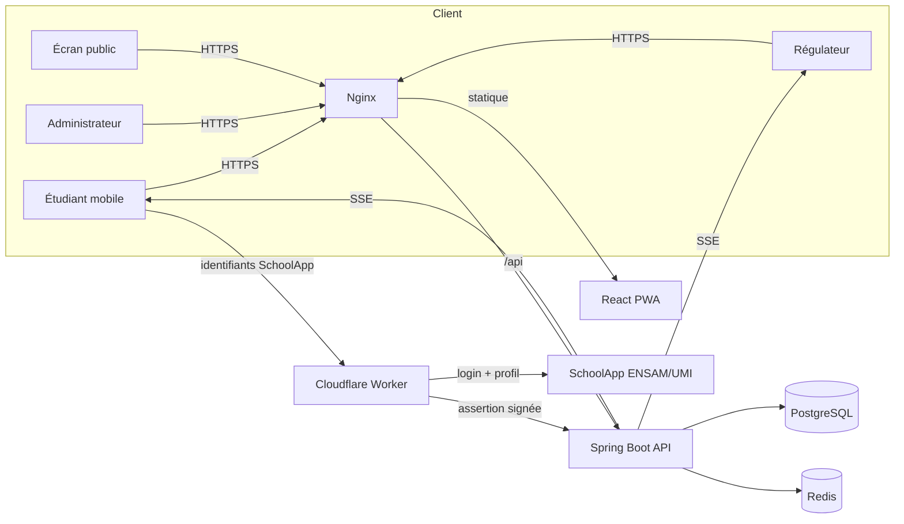

# Architecture

## Vue d'ensemble

## Composants

### Backend (`services/api`)
- **Modules** : `domain` (entités JPA), `repository` (Spring Data), `service` (métier : `QueueEngine`, `AuthService`, `CampaignService`, `AnalyticsService`), `web` (contrôleurs REST + DTO), `security` (authentification/autorisation), `realtime` (SSE + Redis).
- **Autoritaire** : l'ordre FIFO, les horodatages, les transitions d'état, l'éligibilité et les affectations sont calculés exclusivement côté serveur.
- **Sessions** : sessions HTTP stockées dans Redis (`spring-session-data-redis`), cookies `HttpOnly`/`Secure`/`SameSite=Lax`, rotation d'identifiant de session contre la fixation.
- **CSRF** : cookie `XSRF-TOKEN` + en-tête `X-XSRF-TOKEN` (pattern SPA standard).

### Temps réel
- **SSE** comme canal primaire serveur→client (authentifié, ré-autoconnexion automatique, délivrable derrière proxys). Les événements sont publiés sur Redis (`fame:campaign:{id}`, `fame:student:{registrationId}`) puis diffusés localement — prêt pour le scaling horizontal.
- **Repli** : le client refait du polling via TanStack Query si SSE échoue.
- **Règle** : jamais de file globale diffusée aux étudiants (canal par étudiant uniquement).

### Worker SchoolApp (`workers/schoolapp-auth`)
Voir [`auth-trust-boundary.md`](auth-trust-boundary.md). Narrowly scoped : `POST /login` et `GET /public-key`.

### Données
Voir [`database.md`](database.md).

## Versions épinglées (résumé)
- Spring Boot 3.3.5, Java 17, PostgreSQL 16, Redis 7, nimbus-jose-jwt 9.41.1, web-push 5.1.1, Testcontainers 1.21.4, Flyway (géré par Spring Boot).
- React 18.3.1, Vite 5.4.10, TanStack Query 5.59.16, vite-plugin-pwa 0.21.0.
- `schoolapp.js` épinglé au commit `d89de2a` (v2.5.3), patché et vendé dans le Worker.
