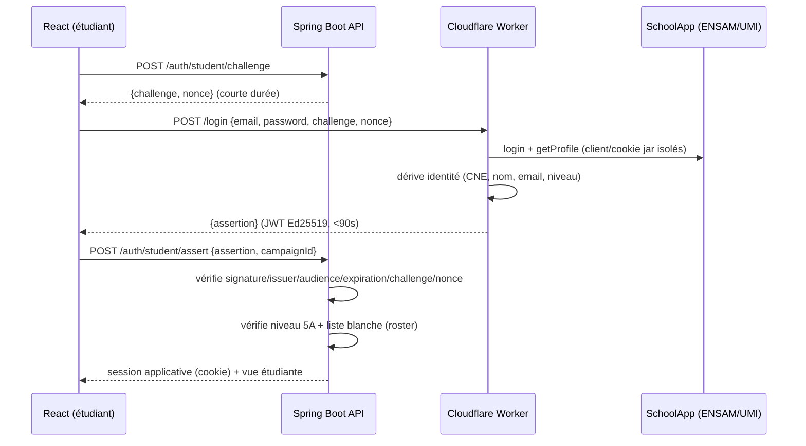

# Authentification & frontière de confiance

## Flux d'authentification étudiant (SchoolApp)

## Frontières de confiance

- **Frontière 1 — Worker ↔ SchoolApp** : le Worker est le *seul* composant qui parle à SchoolApp. Client et cookie jar frais par tentative ; aucun état partagé ; redirections épinglées à l'origine allowlistée.
- **Frontière 2 — React ↔ Worker** : React transmet les identifiants *une seule fois* au Worker et ne conserve jamais l'assertion.
- **Frontière 3 — React ↔ API** : l'assertion est vérifiée par l'API (clé publique), liée à un challenge et à un nonce à usage unique (anti-rejeu atomique).
- **Frontière 4 — sessions** : l'API établit ses propres sessions (Redis). Les cookies SchoolApp ne sont jamais réutilisés.

## Garanties réelles vs. hypothèses

- L'intégration `schoolapp.js` fournit une **authentification par identifiant/mot de passe** contre le portail SchoolApp (pas d'OAuth institutionnel). Aucun flux OAuth n'est inventé : nous utilisons uniquement la capacité vérifiée.
- L'identité est dérivée du **profil SchoolApp** (`CNE/Masar`). La filière d'éligibilité provient du **roster importé par le comité**, jamais de l'assertion.
- Le secret de signature (`SIGNING_PRIVATE_KEY`) réside **uniquement** dans les secrets Cloudflare Worker. L'API ne détient que la clé publique.

## Audit du paquet `schoolapp.js` (v2.5.3, commit `d89de2a`)

Constatations principales :

1. **Mix CJS/ESM** : `auth.js` et `managers/index.js` utilisaient `import`/`export` alors que le reste de la lib est en CommonJS ; `index.js` les charge via `require`. Le paquet ne fonctionne que sur Node ≥ 22 (`require(esm)`). **Patch** : conversion de ces fichiers en CJS (voir `workers/schoolapp-auth/vendor/src/`).
2. **Journalisation sensible** : `console.log` du jeton CSRF (tronqué) et dumps de contenu de la page de login. **Patch** : suppression de ces logs.
3. **Suivi de redirections ouvert** : `http_client.js` suivait n'importe quelle destination `location`. **Patch** : épinglage de l'origine.
4. **Cookie jar isolé par instance** : OK — chaque `SchoolAppClient` possède son propre `CookieJar`, sans état mutable partagé.
5. **Timeouts** : timeout de 15 s par défaut via `AbortController`. OK.

Les patchs sont documentés, minimaux et couverts par les tests du Worker (succès, échec d'authentification, champs manquants, payload surdimensionné, assertion signée vérifiable).

## Rôles et autorisation

| Rôle | Accès |
|------|-------|
| `ADMIN` | Tout (campagnes, roster, exports, audit). |
| `ORGANIZER` | Uniquement les campagnes assignées (`CampaignAccessService`). |
| `STUDENT` | Uniquement sa propre inscription (`StudentPrincipal`). |
| Public | Feed d'affichage public restreint, sans donnée personnelle. |

La logique d'autorisation est appliquée côté serveur sur chaque route ; les guards React ne sont qu'une mesure d'ergonomie.
