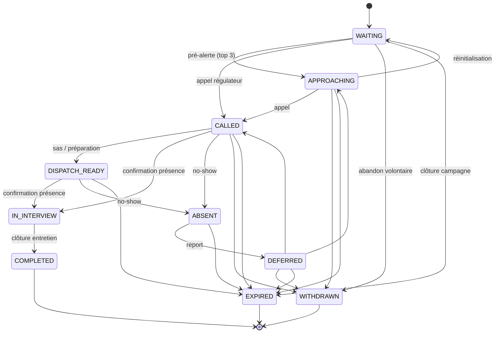

# Machine à états de la file d'attente

## États

| État | Signification |
|------|---------------|
| `WAITING` | En file, éligible à la sélection. |
| `APPROACHING` | Pré-alerté (parmi les 3 prochains), se dirige vers la zone d'attente. |
| `CALLED` | Appelé officiellement par un régulateur (verrouillé). |
| `DISPATCH_READY` | Dans le sas de préparation, physiquement prêt. |
| `IN_INTERVIEW` | En entretien (poste occupé). |
| `ABSENT` | No-show ; peut être reporté en `DEFERRED`. |
| `DEFERRED` | Reporté après une absence (réintègre la file). |
| `COMPLETED` | Entretien terminé (terminal). |
| `WITHDRAWN` | Abandon volontaire (terminal). |
| `EXPIRED` | Campagne clôturée avant l'entretien (terminal). |

## Règles

- Les transitions sont validées **côté serveur** par `QueueStateMachine` (transitions non autorisées → 409).
- Un candidat `CALLED`/`DISPATCH_READY`/`IN_INTERVIEW` est **retiré immédiatement** du pool de sélection des autres postes.
- **Anti-famine** : si aucune correspondance sur la filière demandée, le système propose les candidats des autres filières en ordre FIFO — sans affectation automatique.
- **Pénalité no-show** : politique *configurable*, sans règle universelle imposée (décision métier requise — voir [`README` des risques](../reports/security/README.md)).
- L'abandon volontaire (`WITHDRAWN`) retire immédiatement le profil des filtres et audite l'action.
